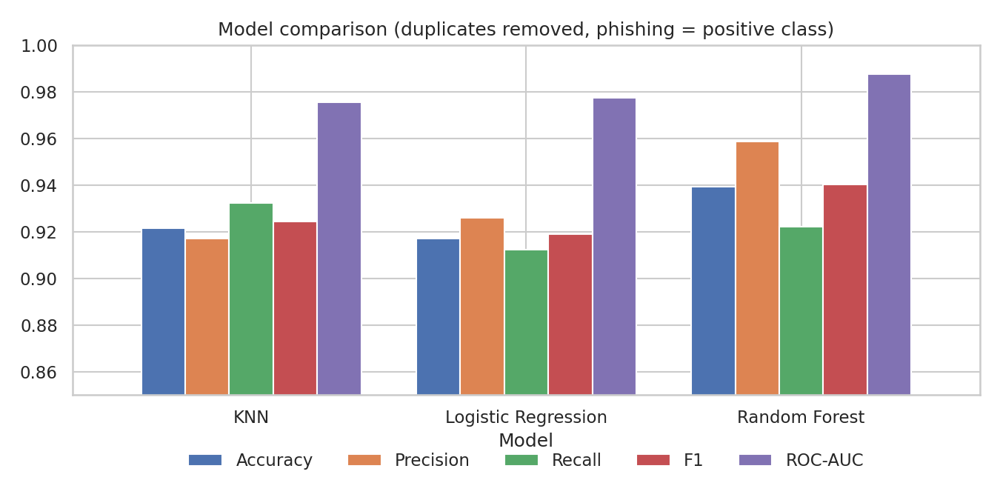
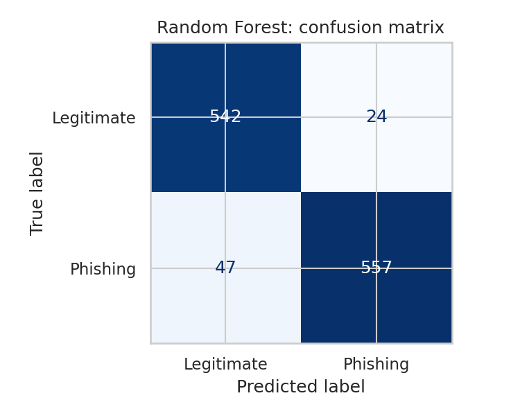
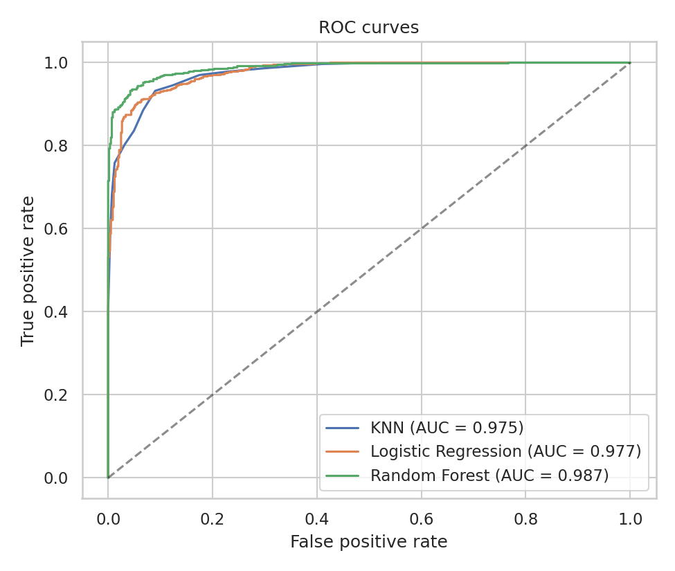
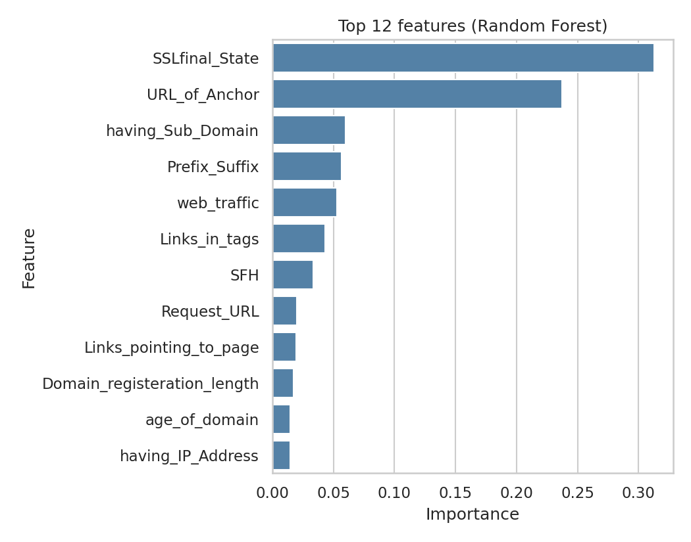

# Phishing Website Detection

   

> **Result:** Random Forest reaches **93.9% accuracy** and **92.2% recall** on phishing sites. While building it I found that **47% of the dataset is duplicate rows**, which pushes the score up to 97.7% if you ignore it.

[Notebook](phishing_detection.ipynb) | [Results](#results) | [Method](#method) | [Run it](#run-it) | [Limitations](#limitations)

A machine learning project in Python that classifies websites as **phishing** or **legitimate** using 30 pre-extracted features (URL length, IP address in the URL, SSL state, domain age, link structure, and so on).

I trained and compared three models (K-Nearest Neighbors, Logistic Regression, Random Forest), tuned each one with 5-fold cross-validation, and checked how much the results change when the dataset's duplicate rows are handled properly.

## Results

Test set: 1,170 websites. Phishing is the positive class.

| Model | Accuracy | Precision | Recall | F1 | ROC-AUC |
|---|---|---|---|---|---|
| **Random Forest** | **0.939** | **0.959** | 0.922 | **0.940** | **0.987** |
| KNN | 0.921 | 0.917 | **0.932** | 0.925 | 0.975 |
| Logistic Regression | 0.917 | 0.926 | 0.912 | 0.919 | 0.977 |

The best model, Random Forest, caught 557 of the 604 phishing sites in the test set and wrongly flagged 24 of the 566 legitimate ones.



<table>
<tr>
<td></td>
<td></td>
</tr>
</table>

## What I found along the way

* **47% of the dataset is duplicate rows** (5,206 of 11,055). The features only take the values -1, 0 and 1, so many sites share an identical row. When duplicates are kept, identical rows end up in both the training and test sets and the scores look better than they are: Random Forest accuracy goes from 93.9% to 97.7%.
* My first version of this project (no tuning, no duplicate removal, features scaled before the train/test split) reported 97% for Random Forest and 94% for KNN. After fixing those problems the honest figure for Random Forest is about 94%.
* The two most important features in the Random Forest are `SSLfinal_State` (31%) and `URL_of_Anchor` (24%).



## Method

1. Load the ARFF file and check for missing values and duplicates.
2. Remove duplicate rows, then split 80/20 with a stratified split, so both sets keep the same class balance.
3. Scale features inside a scikit-learn `Pipeline` (only for KNN and Logistic Regression), so the scaler learns from training data only.
4. Tune each model with `GridSearchCV` (5-fold stratified cross-validation, scoring on F1).
5. Evaluate on the held-out test set with accuracy, precision, recall, F1, ROC-AUC, confusion matrix and ROC curves.

## Run it

```
git clone https://github.com/chefxx1/phishing-website-detection.git
cd phishing-website-detection
python -m venv venv
venv\Scripts\activate
pip install -r requirements.txt
jupyter notebook phishing_detection.ipynb
```

On macOS or Linux, activate the environment with `source venv/bin/activate`.

## Project structure

```
phishing-website-detection/
├── phishing_detection.ipynb   # the full analysis
├── data/                      # dataset (see data/README.md for the source)
├── figures/                   # charts used in this README
├── results/                   # model comparison table (CSV)
└── requirements.txt
```

## Limitations

* The dataset contains pre-computed features, not URLs, so these models cannot classify a new URL on their own.
* The data is old, and the results come from a single train/test split. They show how the models behave on this dataset, not how they would perform on phishing sites today.
* In security work a missed phishing site is worse than a false alarm. Recall is 92%, so about 1 in 13 phishing sites is missed. Lowering the decision threshold would trade some precision for recall. I have not done that yet.

## Dataset

UCI *Phishing Websites* dataset, licensed CC BY 4.0. See [`data/README.md`](data/README.md) for the full citation.
